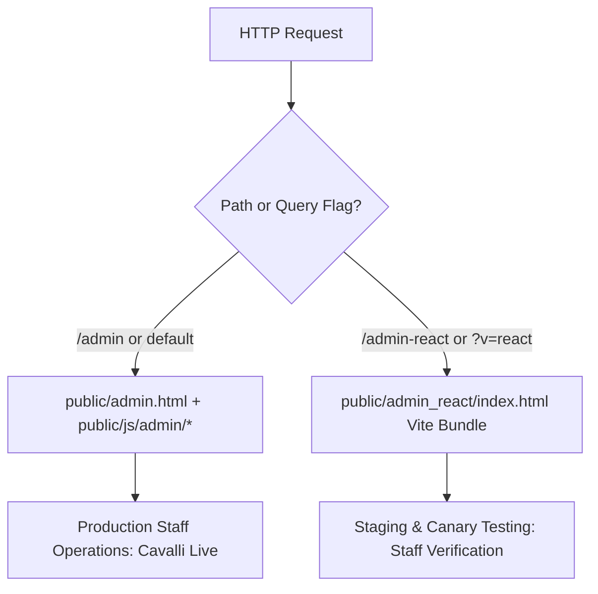

# Benzin Hospitality OS — Deployment & Environment Safety Audit
**Migration Branch**: `refactor/react-admin-migration`  
**Remote Repository**: `https://github.com/sandip10nepal/cavali-backend.git`  
**Target Environment**: Production Cavalli Lounge (`cavali` / `4821`)  
**Safety Protocol**: Strictly Non-Destructive, Isolated, & Zero-Downtime

---

## 1. Safety Mandate & Production Guardrails

The production environment is actively serving customers and staff at Cavalli Lounge. The following invariants are strictly enforced throughout the React migration:

1. **NO Cloud Run Deployments**: No deployment commands (`gcloud run deploy`, `docker push`, or automated triggers) may be executed during this work.
2. **NO Production Database Resets or Seeders**: The authoritative MongoDB Atlas cluster (`benzin_saas_db`) must never be dropped, truncated, migrated, or re-seeded.
3. **NO Modification of Production Secrets**: `.env` and production environment variables must remain untouched.
4. **NO Disruption to `public/admin.html`**: The legacy admin HTML and its 17 extracted ES modules (`public/js/admin/*.js`) must remain fully operational in `public/` at all times.
5. **NO Force Pushing**: `git push --force` is prohibited across all branches. `main` is protected and will only receive changes via pull requests after full manual verification.

---

## 2. CI/CD & Deployment Workflow Audit

An exhaustive audit of the repository's configuration files confirms:

```
[Audit Check 1] GitHub Actions:
$ ls -la .github/workflows/
-> No .github/workflows directory exists.
-> Status: SAFE. Pushing refactor/react-admin-migration CANNOT trigger any automated GitHub Action workflow.

[Audit Check 2] Google Cloud Build Triggers:
$ ls -la cloudbuild*
-> No cloudbuild files exist in repository.
-> Status: SAFE. No Cloud Build triggers exist on branch push.

[Audit Check 3] Containerization & Dockerfile:
$ cat Dockerfile
-> Exposes port 8080, compiles backend with `npm run build`, and starts `node dist/server.js`.
-> Status: SAFE. Container image is only built during explicit manual deployment invocations.

[Audit Check 4] Remote Tracking:
$ git branch -vv
-> refactor/react-admin-migration -> origin/refactor/react-admin-migration
-> Status: SAFE. Branch is completely isolated from origin/main.
```

**Conclusion**: Pushing commits to `refactor/react-admin-migration` on GitHub is **100% safe** and carries zero possibility of triggering an accidental production deployment.

---

## 3. Database Safety & Data Preservation Protocol

1. **Production Mode Invariant**: In `src/config/env.ts`, `DATABASE_MODE=mongodb` enforces that MongoDB Atlas is authoritative. Any attempt to fall back to an unverified local JSON database in production throws a fatal runtime exception.
2. **Write Boundary Protocol**: All database operations must go through existing service abstractions (`MultiTenantDbService`, `OrderService`, `UserRepository`). Direct write scripts or mass collection alterations are prohibited.
3. **Test Isolation**: When executing local regression tests, ephemeral in-memory or transactional isolation is used to ensure test tickets do not corrupt operational reporting.

---

## 4. Dual-Mount Serving Strategy & Canary Rollout

During development, the Express server will support both versions concurrently:



### Safety Advantages of Dual-Mounting:
1. **Zero Downtime**: The existing `/admin` route continues to serve the verified `admin.html` without modification.
2. **Live Side-by-Side Comparison**: Developers and managers can open `/admin` and `/admin-react` side-by-side on the same network to compare ticket updates in real time.
3. **Instant Rollback**: If any discrepancy or edge-case bug is discovered in the React app, reverting the primary route is a 1-line change in `src/server.ts` with zero risk of database corruption.
4. **Gradual Cutover**: Once user approval is granted, the primary route `/admin` is repointed to `/admin_react`, and the legacy interface is preserved under `/admin-legacy` for 30 days as a safety net.
