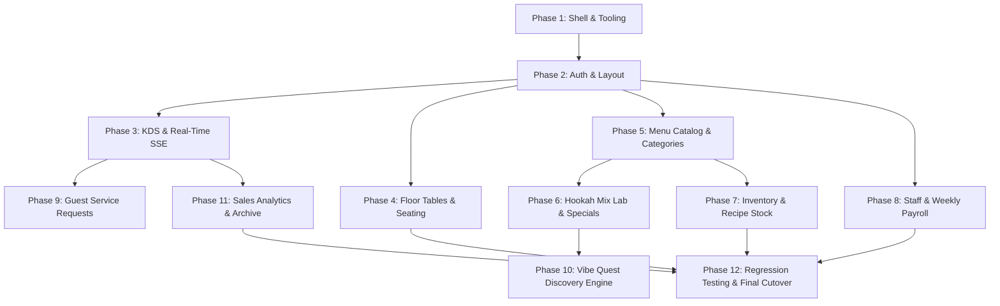

# Benzin Hospitality OS — Incremental Migration Plan
**Target**: Full React + TypeScript + Vite Admin Panel  
**Source Baseline**: `refactor/react-admin-migration`  
**Deployment Strategy**: Parallel Canary Mount → Comprehensive Regression → Zero-Downtime Cutover

---

## 1. Migration Sequence & Dependency Graph

---

## 2. Phase-by-Phase Execution Details

### Phase 1: Tooling, Vite Setup & Application Shell
- **Existing Files**: `package.json`, `tsconfig.json`, `public/admin.html` (CSS tokens).
- **New Files**:
  - `src/admin/vite.config.ts` (Isolated Vite config targeting build output to `public/admin_react/`).
  - `src/admin/index.html` (Vite HTML template importing `src/admin/main.tsx`).
  - `src/admin/main.tsx`, `src/admin/App.tsx`.
  - `src/admin/styles/tokens.css` (Extract all CSS variables from `admin.html`).
- **APIs Reused**: None (tooling setup).
- **Dependencies**: `react`, `react-dom`, `@types/react`, `@types/react-dom`, `vite`, `@vitejs/plugin-react`, `lucide-react`.
- **Breaking Changes**: None. No production runtime files altered.
- **Testing**: Run `npm run build:admin` and verify static artifact generation without impacting root TypeScript compilation.
- **Rollback**: Delete `src/admin/` build folder.

### Phase 2: Navigation, Layout & Authentication
- **Existing Files**: `public/js/admin/auth.js`, `navigation.js`, `api.js`, `state.js`.
- **New Components**:
  - `AuthContext.tsx`, `TenantContext.tsx`, `ThemeContext.tsx`.
  - `AdminLayout.tsx`, `Sidebar.tsx`, `Header.tsx`, `ShiftTimerWidget.tsx`.
  - `LoginModal.tsx` (Venue PIN + Staff Roster Dropdown + PIN Pad / Manager email tabs).
  - `StaffSwitchModal.tsx` (In-person numeric PIN pad).
- **APIs Reused**:
  - `POST /api/auth/staff-roster`
  - `POST /api/auth/staff-verify`
  - `POST /api/auth/manager-login`
  - `POST /api/employees/verify-pin`
- **Testing**: Test staff login as Server, test manager login, test staff quick-switch, verify shift duration ticker increments every second.

### Phase 3: KDS & Real-Time SSE Stream
- **Existing Files**: `public/js/admin/kds.js`, `sse.js`, `utils.js` (`orderChime`).
- **New Components**:
  - `SSEContext.tsx` (Authoritative `EventSource` subscriber).
  - `AudioChimeContext.tsx` (Sound policy unlock and audio playback).
  - `KdsView.tsx`, `TicketCard.tsx`, `TicketItemsList.tsx`.
  - `CollectCashModal.tsx` (Cash tender calculation, change due).
- **APIs Reused**:
  - `GET /api/orders/live` (SSE stream)
  - `GET /api/orders`
  - `PUT /api/orders/:id/status`
  - `PUT /api/orders/:id/fulfill`
  - `POST /api/orders/:id/cash`
- **Testing**: Submit simulated order from table 1; verify sound chime triggers, ticket card renders instantly without page reload, status transitions smoothly to Prep/Ready/Served.

### Phase 4: Floor Tables & Seating Management
- **Existing Files**: `public/js/admin/tables.js`.
- **New Components**:
  - `TablesView.tsx`, `TableCard.tsx`.
  - `AddTableModal.tsx`, `EditTableModal.tsx`.
  - `ReassignServerModal.tsx`.
- **APIs Reused**:
  - `GET /api/tables`
  - `POST /api/tables` (Supports alphanumeric labels like `P1`, `P2`)
  - `PUT /api/tables/:id`
  - `DELETE /api/tables/:id`
  - `POST /api/tables/reset`
- **Testing**: Add table `P9`, verify alphanumeric label preserves, assign server, quick-reset table to available.

### Phase 5: Menu Catalog & Categories
- **Existing Files**: `public/js/admin/menu.js`.
- **New Components**:
  - `MenuView.tsx`, `MenuItemCard.tsx`.
  - `AddItemModal.tsx` (Recipe ingredients, image URL, allergens, description).
  - `AddCategoryModal.tsx`.
- **APIs Reused**:
  - `GET /api/v2/menu/categories`
  - `GET /api/v2/menu/items`
  - `POST /api/menu`
  - `PUT /api/menu/:id`
  - `DELETE /api/menu/:id`
- **Testing**: Verify supercategories (`FOOD & DINING`, `BEVERAGES`, `HOOKAH & SHISHA`), edit item price under Appetizers and confirm category independence (item IDs remain split).

### Phase 6: Hookah Mix Lab & Curated Specials
- **Existing Files**: `public/js/admin/hookah.js`, `specials.js`.
- **New Components**:
  - `HookahLabView.tsx`, `BasesTab.tsx`, `FlavorsTab.tsx`, `PackagesTab.tsx`.
  - `SpecialsView.tsx`.
- **APIs Reused**:
  - `GET /api/menu/hookah-config` & `PUT /api/menu/hookah-config`
  - `GET /api/menu/specials` & `PUT /api/menu/specials`
- **Testing**: Verify Daku package applies $65 with unlimited head refill, toggle ice base/hose availability, feature dish on specials board.

### Phase 7: Inventory & Stock Tracking
- **Existing Files**: `public/js/admin/inventory.js`.
- **New Components**:
  - `InventoryView.tsx`, `InventoryRow.tsx`.
  - `AddInvItemModal.tsx`, `EditInvItemModal.tsx`.
- **APIs Reused**:
  - `GET /api/menu/inventory`
  - `POST /api/menu/inventory/adjust`
  - `POST /api/menu/inventory`
  - `PUT /api/menu/inventory/:id`
  - `DELETE /api/menu/inventory/:id`
- **Testing**: Click `+10`, `+50`, `-10` buttons; verify instant optimistic update and server confirmation. Verify low stock alert threshold indicator.

### Phase 8: Staff Roster & Weekly Payroll
- **Existing Files**: `public/js/admin/staff.js`.
- **New Components**:
  - `StaffView.tsx`, `StaffCard.tsx`.
  - `PayrollSummaryCard.tsx`.
  - `AddEmployeeModal.tsx`, `EditEmployeeModal.tsx`.
- **APIs Reused**:
  - `GET /api/employees` (Verify wage masking for non-managers)
  - `POST /api/employees`
  - `PUT /api/employees/:id`
  - `GET /api/employees/payroll/summary` (Verify HTTP 403 when called as Server)
- **Testing**: Log in as Server: verify payroll summary card is hidden and wage displays `Protected`. Log in as Manager: verify calculated weekly payroll hours and gross totals render accurately.

### Phase 9: Guest Service Requests & Vibe Quest Engine
- **Existing Files**: `public/js/admin/service-requests.js`, `vibe-quest.js`.
- **New Components**:
  - `ServiceRequestsView.tsx`.
  - `VibeQuestView.tsx`, `QuestSimulator.tsx`.
- **APIs Reused**:
  - `GET /api/service-requests` & `PUT /api/service-requests/:id/status`
  - `GET /api/vibe-quest/config` & `PUT /api/vibe-quest/config`
- **Testing**: Trigger guest call bell; verify card lights up in admin. Configure discovery question and run simulation preview.

### Phase 10: Financial Sales Analytics & Order Archive
- **Existing Files**: `public/js/admin/sales.js`, `kds.js` (archive methods).
- **New Components**:
  - `SalesView.tsx`, `PaymentBreakdownChart.tsx`.
  - `ArchiveView.tsx`, `ClearArchiveModal.tsx`.
- **APIs Reused**:
  - `GET /api/orders/sales/summary`
  - `POST /api/orders/archive/clear` (Supervisor PIN validation)
- **Testing**: Verify gross sales aggregation, cash vs digital card breakdown, test supervisor PIN prompt before clearing archive tickets.

### Phase 11: End-to-End Regression & Canary Cutover
- **Execution**:
  1. Mount React application at `/admin-react` in `src/server.ts`.
  2. Run entire 19-test admin workflow suite against the React endpoints.
  3. Perform parallel side-by-side verification in browser.
  4. Obtain stakeholder sign-off from user.
  5. Promote React admin build to `/admin` route in `server.ts`.
  6. Retain `admin.html` as fallback at `/admin-legacy` for 30 days.

---

## 3. Risk Mitigation & Rollback Strategy

| Potential Risk | Root Cause | Preventive Design | Rollback Mechanism |
|---|---|---|---|
| **KDS Missed Orders** | SSE disconnect or network hiccup | SSE reconnection hook with backoff + stale data refresh on window focus | Immediate revert to `admin.html` |
| **RBAC Leak** | Leaking manager data to server role | Reusing server-side route guards; React UI guards merely mirror backend RBAC | Backend blocks unauthorized requests with 403 |
| **Category Independence Bug** | Accidental item ID collision across categories | Reusing existing category splitting endpoint logic | Database preserves distinct item IDs |
| **Audio Notification Block** | Browser autoplay policy | Global user gesture listener in `AudioChimeContext` | Audio fallback visual flashing banner |
