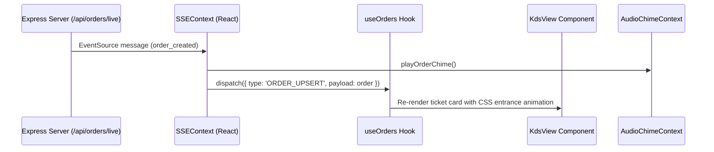

# Benzin Hospitality OS — Proposed React Architecture
**Module**: Admin Dashboard (React + TypeScript + Vite)  
**Target Baseline**: `refactor/react-admin-migration`  
**Framework**: React 18 / 19, TypeScript 5.4+, Vite 5+

---

## 1. Architectural Principles

1. **Zero Production Disruption**: The React admin application must be developed, bundled, and tested alongside the existing `admin.html` without replacing or corrupting it until full regression sign-off.
2. **Type Safety End-to-End**: Leverage the existing authoritative TypeScript models in `src/models/types.ts` to ensure 100% type safety across API calls, state, and component props.
3. **Decoupled Feature Modules**: Break the monolithic DOM approach into isolated, testable feature directories (`kds`, `tables`, `menu`, `inventory`, `staff`, `sales`, `service-requests`, `vibe-quest`).
4. **Resilient Real-Time Engine**: Replace dual polling/SSE loops with a dedicated `SSEProvider` context managing reconnects, backoff, and state reconciliation.
5. **No Unnecessary External Dependencies**: Rely on native React primitives (`useContext`, `useReducer`, `useMemo`), Lucide React icons, and a lean routing structure to maintain fast load times and clean bundle size.

---

## 2. Directory Structure (`src/admin/`)

The React admin code will live cleanly inside the backend codebase under `src/admin/` to allow direct access to backend TypeScript types without duplicating type files:

```
src/admin/
├── index.html                   # Vite entry HTML
├── main.tsx                     # Vite application bootstrap
├── App.tsx                      # Root component with Providers & Router
├── vite.config.ts               # Isolated Vite build configuration
│
├── api/                         # Typed API Client Layer
│   ├── client.ts                # Base fetch client with JWT & tenant headers
│   ├── auth.api.ts              # Login, staff-roster, staff-verify, PIN quick-switch
│   ├── orders.api.ts            # KDS orders, status updates, fulfillment, cash pay
│   ├── tables.api.ts            # Floor tables list, CRUD, server assignment
│   ├── menu.api.ts              # Categories, items, hookah config, specials
│   ├── inventory.api.ts         # Stock list, +/- adjustments, category CRUD
│   ├── staff.api.ts             # Employee roster, payroll summary, PIN verify
│   └── vibe-quest.api.ts        # Questionnaire configuration and simulation
│
├── context/                     # Shared Global Contexts
│   ├── AuthContext.tsx          # Current staff/manager session, role, JWT token
│   ├── TenantContext.tsx        # Active restaurant slug, code, venue name, settings
│   ├── SSEContext.tsx           # Real-time event stream subscription & notifications
│   ├── ThemeContext.tsx         # Dark / Light theme persistence & CSS variables
│   └── AudioChimeContext.tsx    # Audio policy unlocking and order bell chimes
│
├── layouts/                     # Core Layout Shell
│   ├── AdminLayout.tsx          # Main shell with responsive grid
│   ├── Sidebar.tsx              # Collapsible navigation drawer with lock badges
│   ├── Header.tsx               # Top bar (venue, staff badge, clock timer, theme)
│   └── ShiftTimerWidget.tsx     # Active shift clock-in duration ticker
│
├── components/common/           # Reusable UI Atoms & Molecules
│   ├── Button.tsx               # Styled primary, secondary, danger, ghost buttons
│   ├── Modal.tsx                # Accessible portal dialog with backdrop
│   ├── PinPad.tsx               # 4-digit numeric keypad for staff login & switch
│   ├── Badge.tsx                # Role badges (Owner, Manager, Server, etc.)
│   ├── StatusPill.tsx           # Order & Table status pills (Ready, Prep, etc.)
│   ├── Input.tsx                # Styled text/number inputs with label and error
│   ├── Select.tsx               # Styled native select wrapper
│   ├── Switch.tsx               # Boolean toggle switch for active states
│   └── ErrorBoundary.tsx        # React error boundary with fallback UI
│
├── features/                    # Feature-Specific Views & Modals
│   ├── auth/                    # Login overlay, PIN pad, Manager email login
│   │   ├── LoginModal.tsx
│   │   └── StaffSwitchModal.tsx
│   ├── kds/                     # Kitchen / Hookah Display System
│   │   ├── KdsView.tsx
│   │   ├── TicketCard.tsx
│   │   ├── TicketItemsList.tsx
│   │   └── CollectCashModal.tsx
│   ├── tables/                  # Floor Layout & Table Seating
│   │   ├── TablesView.tsx
│   │   ├── TableCard.tsx
│   │   ├── AddTableModal.tsx
│   │   ├── EditTableModal.tsx
│   │   └── ReassignServerModal.tsx
│   ├── menu/                    # Menu Catalog & Ordering Questions
│   │   ├── MenuView.tsx
│   │   ├── MenuItemCard.tsx
│   │   ├── AddItemModal.tsx
│   │   ├── AddCategoryModal.tsx
│   │   └── QuestionBuilderModal.tsx
│   ├── hookah/                  # Hookah Mix Lab
│   │   ├── HookahLabView.tsx
│   │   ├── BasesTab.tsx
│   │   ├── FlavorsTab.tsx
│   │   └── PackagesTab.tsx
│   ├── inventory/               # Stock & Ingredients Tracking
│   │   ├── InventoryView.tsx
│   │   ├── InventoryRow.tsx
│   │   ├── AddInvItemModal.tsx
│   │   └── EditInvItemModal.tsx
│   ├── staff/                   # Roster, Wages & Payroll
│   │   ├── StaffView.tsx
│   │   ├── StaffCard.tsx
│   │   ├── PayrollSummaryCard.tsx
│   │   └── EditEmployeeModal.tsx
│   ├── sales/                   # Financial Analytics & Reports
│   │   ├── SalesView.tsx
│   │   └── PaymentBreakdownChart.tsx
│   ├── service-requests/        # Guest Call Bell & Coal Refills
│   │   └── ServiceRequestsView.tsx
│   ├── specials/                # Curated Specials Board
│   │   └── SpecialsView.tsx
│   ├── vibe-quest/              # Flavor Discovery Engine
│   │   ├── VibeQuestView.tsx
│   │   └── QuestSimulator.tsx
│   └── archive/                 # Completed Tickets & Audit Trail
│       ├── ArchiveView.tsx
│       └── ClearArchiveModal.tsx
│
├── hooks/                       # Custom React Hooks
│   ├── useOrders.ts             # Fetching, caching, filtering KDS orders
│   ├── useTables.ts             # Floor tables and live order assignments
│   ├── useInventory.ts          # Stock queries and quick +/- adjustments
│   ├── useShiftTimer.ts         # Accurate elapsed time calculation
│   └── useKeyboardShortcuts.ts  # POS & KDS hotkeys (Esc to close modal, etc.)
│
├── types/                       # Extended Frontend Types
│   └── admin.types.ts           # UI-specific state, modal contracts, filter unions
│
└── styles/                      # Design System & Styling
    ├── tokens.css               # Cavalli & Benzin CSS custom properties
    └── admin.css                # Global utilities and reset rules
```

---

## 3. State Management & Real-Time Flow



### Context Details:
1. **`AuthContext`**:
   - Manages `token`, `currentUser`, `role`, and `isClockedIn`.
   - Synchronizes automatically with `localStorage` (`benzin_jwt_token`, `benzin_user_name`, `benzin_user_role`).
   - Automatically handles 401/403 responses by popping the quick-switch PIN pad or redirecting to login.
2. **`TenantContext`**:
   - Resolves restaurant code (default `4821` for Cavalli) and restaurant ID.
   - Supplies `currency` (`$`), `timezone`, and tax calculation settings.
3. **`SSEContext`**:
   - Manages a single authoritative `EventSource` instance.
   - Features exponential backoff reconnection logic.
   - Listens for `order_created`, `order_updated`, `table_updated`, `inventory_updated`, and `request_created`.
   - Completely eliminates the redundant 3-second background polling timer.

---

## 4. Dual-Serving Strategy (Zero-Downtime Guarantee)

To guarantee that production is 100% unaffected during development:
1. **Existing Route Unchanged**: `GET /admin` continues to serve `public/admin.html` as the default fallback.
2. **Parallel React Mount**: In `src/server.ts`, a dedicated route `/admin-react` (or query flag `?v=react`) will serve the compiled React Vite bundle from `public/admin_react/`.
3. **Canary Validation**: Staff can test the React interface at `/admin-react` while the live restaurant continues using `/admin`.
4. **Instant Cutover**: Once full parity and regression testing are signed off, updating one line in `src/server.ts` promotes the React app to the primary `/admin` path.
