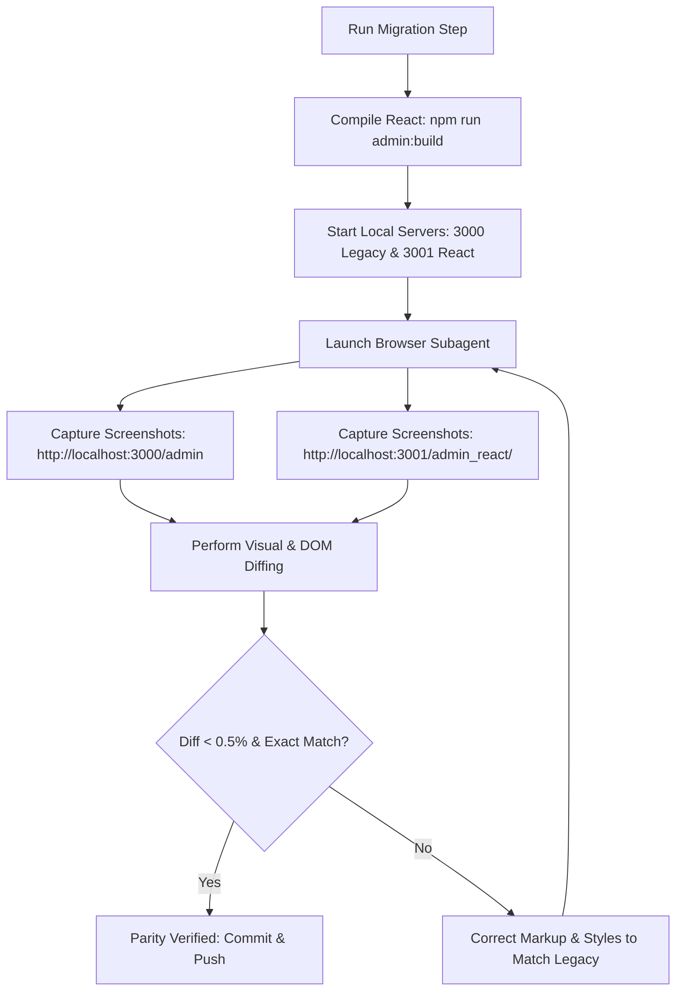

# Benzin Hospitality OS — Visual Regression Plan & Parity Testing Protocol
**Target**: 100% Pixel and Workflow Parity with Legacy Admin  
**Authoritative Reference**: `public/admin.html` (port 3000)  
**React Implementation**: `src/admin/` (port 3001)  
**Acceptance Threshold**: Visual discrepancy < 0.5% & Zero Workflow Differences

---

## 1. Visual Parity Objective & Strategy

The migration from vanilla HTML/ES modules to React + TypeScript + Vite must produce an interface that is visually indistinguishable from `public/admin.html`. 

To achieve this, the migration methodology is adjusted to **Direct DOM Transcription**:
1. **Direct CSS Reuse**: The complete stylesheet from `public/admin.html` (lines 15 to 718) is ported directly into `src/admin/styles/legacy-admin.css`.
2. **Identical Markup Structure**: JSX components will output the exact same HTML element hierarchy, class names, and attributes as the legacy template strings in `public/js/admin/*.js`.
3. **No Redesigns or Placeholders**: Invented components and redesigns are strictly prohibited. Every view and card must render the exact layout of the legacy counterpart.
4. **Verification via Browser Subagent**: Antigravity's browser agent will capture side-by-side screenshots at identical viewports and assert visual parity.

---

## 2. Standardized Viewport Matrix

All visual comparisons must be executed and recorded at the following fixed viewports:

| Viewport Profile | Width x Height | Focus Areas |
|---|---|---|
| **Desktop Full** | `1280 x 800` | Full horizontal top navigation, KDS ticket columns, multi-column table grid, header profile box, timeclock widget |
| **Tablet Portrait** | `768 x 1024` | Overflow navigation tabs scrolling, tablet ticket density, inventory grid wrap |
| **Mobile Portrait** | `375 x 667` | Sticky header with `☰ Menu` button, `#mobileNavDrawerOverlay` full-screen modal, single-column table cards |

---

## 3. State-by-State Visual Parity Matrix

Every primary state must be verified against the running legacy admin on port 3000:

| State ID | Component / View | Legacy Route / Tab | Specific Visual Invariants to Verify |
|---|---|---|---|
| **S1: Header Bar** | `Header.tsx` | All views (sticky top) | Hexagonal Benzin SVG shield, `BENZIN` blue title, restaurant name subtext, horizontal capsule `.nav-tabs`, gold active tab pill, timeclock button with status dot, gold-bordered profile box, theme switcher with label, red logout button |
| **S2: Mobile Menu** | `MobileNavDrawer.tsx` | Mobile viewport click `Menu` | Blurred backdrop overlay (`backdrop-filter: blur(16px)`), card with user profile header, shift clock toggle banner, vertical nav tab list with icons, Close button |
| **S3: Live Tickets (KDS)** | `KdsView.tsx` | `tab-kds` (default view) | Top summary counters, order cards with table badge, time elapsed counter, item lines with modifiers (Ice Base, Ice Hose, sauces), status buttons (`Prep`, `Ready`, `Serve`, `Pay Cash`, `Print`) |
| **S4: Tables Overview** | `TablesView.tsx` | `tab-tables` | Top stat badges (Total 24, Occupied, Available), filter pill bar (`All`, `Available`, `Occupied`), search input, `.tables-grid` with `.table-card` elements, pulsing state pills (`state-new_order`, `state-in_progress`), server assignment pills |
| **S5: Archive Tickets** | `ArchiveView.tsx` | `tab-archive` | Search input, filter buttons, completed orders table with timestamp, table, items, total, and `Clear Archive` button |
| **S6: Inventory Stock** | `InventoryView.tsx` | `tab-inventory` | Dynamic category tabs (`Hookah Shisha`, `Food Ingredients`, `Beverages`, etc.), `.inventory-grid-square` cards with title, large stock counter, quick `+10`, `+50`, `-10` buttons |
| **S7: Menu Catalog** | `MenuView.tsx` | `tab-menu` | Supercategory tabs (`FOOD & DINING`, `BEVERAGES`, `HOOKAH & SHISHA`), subcategory pills, item cards with photo/emoji, title, price, description, and Active toggle |
| **S8: Sales & Tax Ledger**| `SalesView.tsx` | `tab-sales` | Summary metrics cards (Gross sales, Orders, Tips, Tax), payment breakdown (Cash drawer vs Digital cards), transaction table |
| **S9: Staff & Payroll** | `StaffView.tsx` | `tab-staff` | Roster list, role badges, on-shift status pills, shift duration timer, masked wage display (`$XX.XX/hr` vs `Protected`), weekly payroll summary card |
| **S10: Auth Overlay** | `LoginModal.tsx` | Unauthenticated overlay | Large hexagonal shield, Staff PIN mode vs Manager Email mode switcher, Venue ID input with Verify button, Staff dropdown, 4-digit PIN pad |

---

## 4. Component Migration & Code Transcription Rules

To guarantee exact parity without visual deviation:

### Rule 1: Reuse Legacy CSS Directly
Copy the complete CSS stylesheet from `public/admin.html` into `src/admin/styles/legacy-admin.css` and import it in `main.tsx`. Do not write new ad-hoc CSS rules or replace legacy utility classes.

### Rule 2: Preserve Original HTML Tag Structure & Class Names
When converting an HTML template from `public/js/admin/*.js` into a React component:
```html
<!-- LEGACY: public/admin.html line 837 -->
<div class="nav-tabs" id="admin-mobile-navigation">
  <button class="nav-tab active" id="navTab-kds" onclick="switchTab('kds')">
    <i data-lucide="layout-grid" style="width: 15px; height: 15px;"></i>
    <span>Live Tickets</span>
  </button>
</div>
```
Translates directly into:
```tsx
// REACT: src/admin/components/layout/HeaderNavTabs.tsx
<div className="nav-tabs" id="admin-mobile-navigation">
  <button
    className={`nav-tab ${activeTab === 'kds' ? 'active' : ''}`}
    id="navTab-kds"
    onClick={() => onSelectTab('kds')}
  >
    <LayoutGrid style={{ width: 15, height: 15 }} />
    <span>Live Tickets</span>
  </button>
</div>
```

### Rule 3: Use Identical SVG Icons & Lucide Equivalents
The legacy interface uses specific Lucide icons loaded via unpkg:
- `layout-grid` for Live Tickets
- `table-properties` for Tables Overview
- `archive` for Archive Tickets
- `package` for Inventory Stock
- `book-open` for Menu Catalog
- `bar-chart-3` for Sales & Tax Ledger
- `users` for Staff & Payroll
- `user` for User profile box
- `log-out` for Logout button

React components must import and use the exact same Lucide icon names from `lucide-react`.

---

## 5. Visual Regression Verification Workflow

Prior to approving any migration step, the following automated verification routine will be executed:



### Acceptance Criterion ("The Blind Test"):
A Cavalli manager or server switching between `http://localhost:3000/admin` and `http://localhost:3001/admin_react/` must see an identical visual display, identical button positions, identical colors, and identical response behavior.
